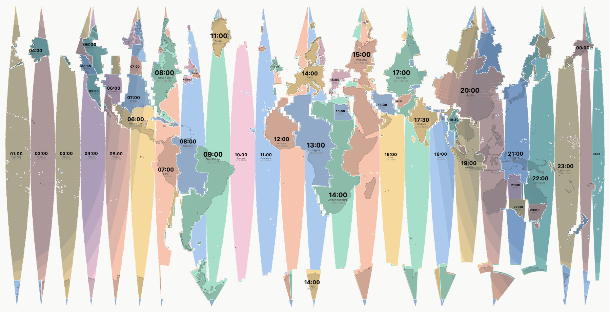
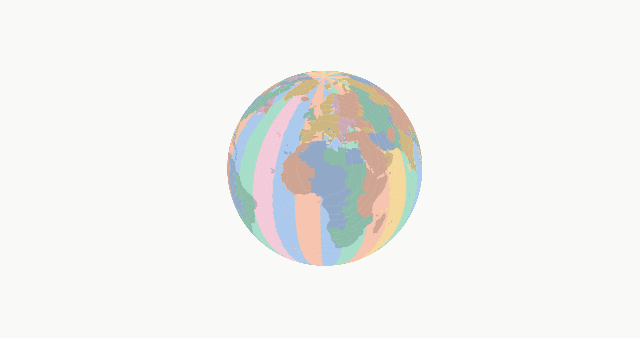
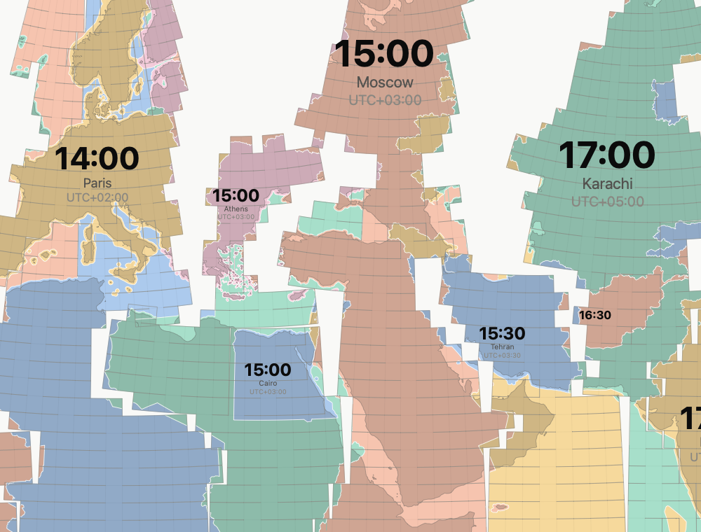
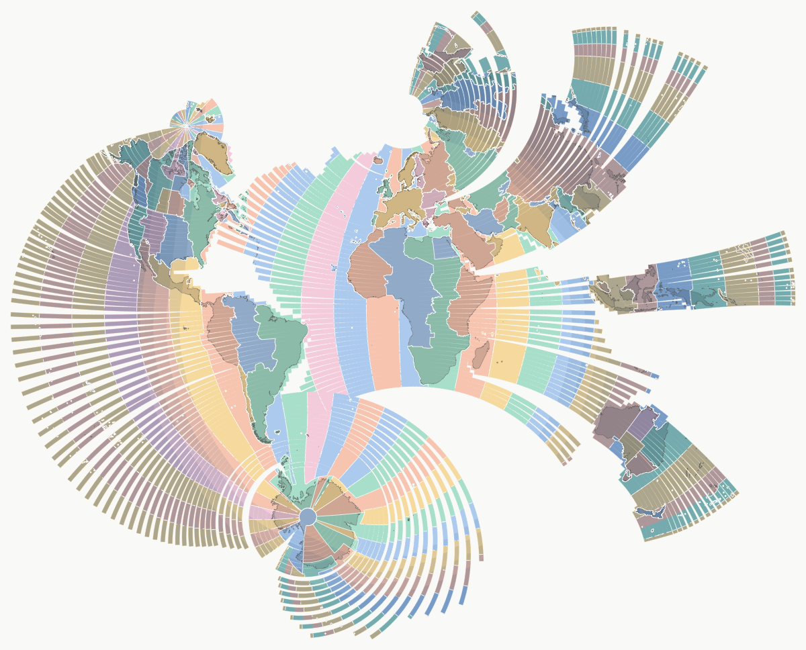
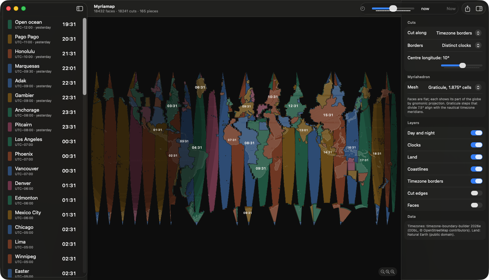
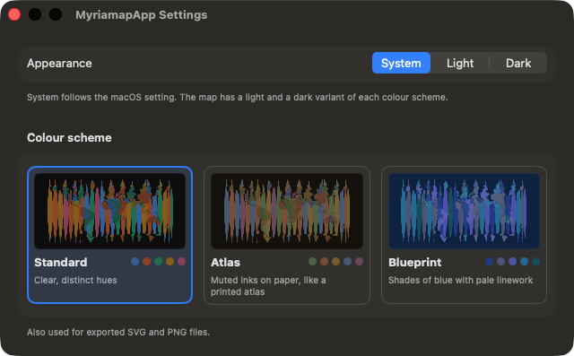
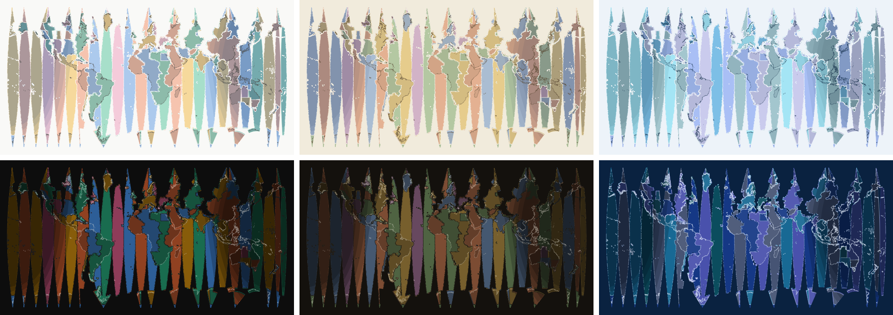

# Myriamap

A timezone app built on the myriahedral projection: the globe is approximated
by a polyhedron with thousands of faces, cut open **along the timezone
borders**, and unfolded flat. Every timezone becomes its own piece of the map,
hanging off an equatorial belt like a globe gore, labelled with its live clock.



References:

- https://github.com/temporaer/myriaworld
- https://vanwijk.win.tue.nl/myriahedral/
- https://vanwijk.win.tue.nl/myriahedral/CAJ103.pdf (J. J. van Wijk, *Unfolding the Earth: Myriahedral Projections*, The Cartographic Journal, 2008)

## The idea

Van Wijk's myriahedral projections map the globe onto a polyhedron with very
many faces (a *myriahedron*) and then unfold it. The faces are nodes of the
*dual graph*; any spanning tree of it is a valid unfolding: tree edges stay
attached as hinges, every other edge is cut. Which tree you choose decides
where the map is interrupted. His maps weigh edges so the cuts run through
the oceans and the continents stay whole.

Myriamap uses the same machinery with a different question: *where does the
clock change?* The cut weights make the seams follow timezone borders, so
the interruptions of the map are themselves information. Folding the map back
up shows that it really is the globe:



## How it works

1. **Myriahedron.** Either a latitude/longitude graticule (default 1.875°
   cells; steps that divide 7.5° align cell edges with the nautical timezone
   meridians) or a geodesic subdivided icosahedron. Every face is a flat
   polygon; the part of the globe it shows is mapped onto it by gnomonic
   projection, so great circles stay straight within a face.
2. **Overlay.** Timezone polygons (oceans included) and land are cut into
   5° tiles, then clipped against every face in its local coordinates. Each
   face gets the zone that covers most of it.
3. **Cuts inside a zone.** A maximum spanning tree over the zone's own edges:
   east–west neighbours first, so rows of faces become strips, then one
   north–south link per row where it is deepest inside the zone. Each zone
   unfolds like a small polyconic map, with hairline slits along parallels
   from the border inwards. The slits are what lets the curved surface lie
   flat.
4. **Joining the zones.** The zone pieces are linked by one hinge each across
   a border, grown outward from the root piece with Prim's algorithm. A
   candidate scores high near the equator and the central meridian, and low
   when it would hang the piece at a tilt. The tilt is exact: once a piece's
   internal tree is fixed, its faces' rotations relative to the hinge are
   known. As a result the zones hang off an equatorial belt, the belt opens
   on the far side of the globe, and zones that never reach the equator
   (the US, Europe, China) still stand upright. Regions that encircle a pole
   (Antarctica keeps New Zealand time) are split into 15° nautical sectors
   for cutting.
5. **Unfolding.** A breadth-first walk over the hinges composes 2D rigid
   motions, so hinged edges coincide exactly. Folding composes 3D hinge
   rotations instead, and every hinge closes by the same fraction of its
   dihedral angle.
6. **Rendering.** A backend-neutral scene (zone fills, land, day/night with
   civil, nautical and astronomical twilight, coastlines, borders, cuts and
   clocks) is drawn to SVG, to PNG through Core Graphics, or in SwiftUI.

Close up, the faces, the staircase cuts along the borders and the slits
inside each zone are visible (`--show-mesh --show-cuts`):



Things to know:

- Borders are cut along face edges, so a cut follows the true border as a
  staircase at mesh resolution. The colours still show the exact border:
  a face on a border carries both zones' fills.
- Neighbouring pieces can overlap slightly at staircase steps where a border
  runs along a parallel. It is about 0.2 % of the map area (`myriamap stats`
  reports it; a test keeps it below 1 %).
- Clocks come from Foundation's `TimeZone`, so daylight saving is included.
  `--grouping utcOffset` cuts only where the offset differs on the given
  date, so the seams move when daylight saving starts or ends.
- `--cuts landmass` switches to van Wijk's ocean-cutting weights for comparison:

  

## The app



A SwiftUI macOS app (macOS 14+):

- the unfolded map with pinch, ⌘-scroll, drag and double-click zoom
- hover cards with local time, abbreviation, UTC offset and coordinates; click to select a zone
- a sidebar of every zone's live clock, sorted by offset, marking "yesterday" and "tomorrow"
- a time scrubber (±24 h) to watch day and night move
- a fold slider and a globe ⇄ map animation
- an inspector for the mesh, cut mode, border grouping, centre longitude and layers
- a Settings window (⌘,) for the appearance (system, light or dark) and the colour scheme
- SVG/PNG export, in the chosen colours



```sh
swift run MyriamapApp            # run straight from the package
./scripts/bundle-app.sh          # or build dist/Myriamap.app (release, signed ad hoc, with icon)
open dist/Myriamap.app
```

### Colour schemes

Each scheme has a light and a dark variant: **Standard** (clear, distinct
hues), **Atlas** (muted inks on paper, like a printed atlas) and
**Blueprint** (shades of blue with pale linework). Top row light, bottom
row dark:



The schemes were tuned against the map as it is drawn, not as swatches.
Zone fills are tinted towards the surface, with land and up to three
night layers on top. The tests check that the clock, place and offset
inks keep 4.5:1, 4:1 and 3:1 contrast over every one of those
backgrounds, and that any two zone fills stay apart (OKLab distance ≥ 5,
since any two can end up neighbours).

## The command-line tool

```sh
swift build -c release
.build/release/myriamap render -o map.svg                    # now, light palette
.build/release/myriamap render -o map.png --dark --width 3200
.build/release/myriamap render --theme atlas -o atlas.png      # standard, atlas or blueprint
.build/release/myriamap render --mesh geodesic:40 --center -90 -o americas.svg
.build/release/myriamap render --grouping utcOffset --date 2026-07-01T12:00:00Z -o summer.png
.build/release/myriamap render --unfold 0.4 -o half-folded.png
.build/release/myriamap animate -o unfold.gif
.build/release/myriamap zone 52.37 4.89                      # region, local time, sun elevation
.build/release/myriamap zones                                 # every region's clock
.build/release/myriamap stats                                 # faces, cuts, pieces, overlap
```

```text
$ myriamap zone 52.37 4.89 --date 2026-10-12T12:00:00Z
52.3700°N 4.8900°E
Region:   Europe/Paris (Paris)
Time:     14:00:00 GMT+2
Offset:   UTC+02:00 (daylight saving)
Sun:      29.7° above the horizon

$ myriamap stats --date 2026-10-12T12:00:00Z
Mesh:            Graticule, 1.875° cells
Faces/vertices:  18432 / 18242
Edges:           36672 (18431 hinges, 18241 cuts)
Border edges:    4003, of which cut: 3839 (95.9%)
Zone groups:     66, pieces: 165
Map size:        6.284 × 3.162
Overlaps:        542 faces, 0.197% of the map area
Build time:      0.14s
```

Building a map takes about 0.15 s after the ~0.1 s data load.

## Tests

```sh
swift test
```

87 tests (Swift Testing) cover the following:

- **Geometry:** Euler characteristic and planarity of the meshes, the spanning tree, hinge
  coincidence and rigidity of the unfolding (cut count = V − 1), point
  location against brute force, projection round trips, clipping, and folding
  (flat = map, closed = polyhedron).
- **Data:** GeoJSON parsing, hole handling, antimeridian and pole artefacts, full
  globe coverage, known cities, nautical ocean offsets, clocks across the date
  line, and the subsolar point at solstices and equinox.
- **Map:** cuts follow borders on synthetic lunes (one equatorial joint
  per pair, the belt opening opposite the centre, upright pieces, slits along
  parallels), overlay coverage of every face, labels on the right region,
  Auckland's clock on New Zealand, overlap below 1 %, graph colouring of
  neighbours, night covering half the globe, and the SVG, PNG and GIF output.
- **Colour:** WCAG contrast and OKLab distance against reference values,
  label legibility and distinct fills in every scheme and variant, and
  scenes painted in the chosen scheme.

## Layout

| Path | Contents |
|---|---|
| `Sources/MyriaGeometry` | vectors, polyhedra, topology, spanning trees, unfolding, folding, point location, clipping |
| `Sources/ZoneAtlas` | GeoJSON, tiled polygon/segment layers, timezone regions and clocks, subsolar point, bundled data |
| `Sources/Myriamap` | face overlay, cut strategies, map builder, labels, colour themes, scenes, SVG/PNG/GIF renderers, viewport |
| `Sources/MyriamapCLI` | the `myriamap` command |
| `Sources/MyriamapApp` | the SwiftUI app |
| `scripts/prepare-data.sh` | downloads and simplifies the data (needs `npx`, uses mapshaper) |
| `scripts/bundle-app.sh` | assembles `dist/Myriamap.app` |

## Data and licences

- Timezones: [timezone-boundary-builder](https://github.com/evansiroky/timezone-boundary-builder)
  release 2026e, *timezones-with-oceans-now* (one region per distinct clock,
  oceans included), simplified to 1 % of its vertices with
  [mapshaper](https://github.com/mbloch/mapshaper) and cleaned so disputed
  overlaps go to the larger zone. © OpenStreetMap contributors, licensed
  under the [ODbL](https://opendatacommons.org/licenses/odbl/).
- Land: [Natural Earth](https://www.naturalearthdata.com) 1:50m land, public domain.

`scripts/prepare-data.sh` regenerates `Sources/ZoneAtlas/Resources` from the
original downloads.
